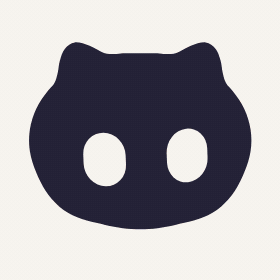
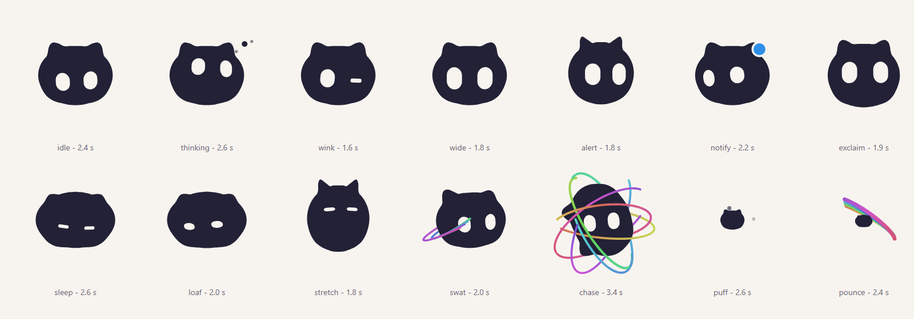

# bloub — an original cat mascot

An animated **cat** in SVG: a wide rounded head with two short, soft ears and
big low eyes, morphing through 14 poses. One filled shape plus two mask holes,
no animation library.

The cat is original work: its head, ears, cheeks, eyes, expressions and poses are
authored analytically in code (`src/bot/cat.ts`), not traced from any video or
character. The project is built on the radial-profile morphing engine of
**[bloub](https://github.com/jeremy-prt/bloub) by Jérémy Perret**, MIT licensed.



## Running it

```bash
pnpm install
pnpm dev
```

Then open http://localhost:5190.

```bash
pnpm test     # vitest
pnpm build    # vue-tsc --noEmit && vite build
```

Vue 3, Vite, TypeScript, Tailwind 4. No ESLint and no Prettier: `vue-tsc` is the
only gate, so run `pnpm build` before you call something done.

## What's in it

The rail on the left switches between three views. **Customise** offers the cat
plus 8 alternative body shapes, 12 colours and 16 rest expressions, kept between
visits. **Animations** is a small editor: arrange states into a timeline, set how
long each is held, save the result. **Settings** holds the language (French,
English or Chinese) and the credits.

Anything on screen can be exported: the cat as SVG, PNG or an animated GIF, and a
whole timeline as GIF or MP4. The still formats need no library at all, and the
video encoder is only fetched the first time you ask for one.

Two URLs are worth knowing:

- `#planche`: the 14 poses side by side, frozen. Quick visual check.
- `#etat=chase&stop`: opens one state directly, playback paused.



## The cat

Everything comes from one polar profile sampled at 64 angles:

- a **wide rounded head** (about 1.19× wider than tall, ears included),
- **soft cheeks** bulging a little at the lower sides,
- **two short rounded ears** on top, leaning slightly outward, built as smooth
  raised-cosine bumps so the outline stays star-shaped and kink-free,
- a flat-ish soft crown between the ears,
- **big, low, slightly tall eyes** kept as holes in the mask.

Four profiles (`cat`, `squish`, `perk`, `tilt`) cover the resting cat, the loaf,
the stretch and the head tilt. The catalogue then tells a small story: idle,
thinking, wink, wide eyes, alert, notification, startled, doze, cat loaf,
stretch, swat, chase, puff up, pounce.

[docs/measurements.md](docs/measurements.md) documents the analytic construction
and every parameter.

## How it's put together

`src/bot/` is framework-free and clock-free: `engine.sample(t)` is a pure
function of time. Pausing, resuming, jumping to an arbitrary date and running
tests all produce the same image, which is what makes the frozen state board and
the DOM-less test suite possible.

| | |
|---|---|
| [docs/architecture.md](docs/architecture.md) | The engine, radial-profile morphing, eyes as mask holes |
| [docs/measurements.md](docs/measurements.md) | The cat's geometry and parameters |
| [docs/intro.md](docs/intro.md) | The arrival sequence, and why it only plays one state |
| [docs/interface.md](docs/interface.md) | Layout, the three-column scene, CSS traps |
| [docs/export.md](docs/export.md) | Exporting to SVG, PNG, GIF and MP4 |
| [docs/i18n.md](docs/i18n.md) | The hand-rolled translation layer |

## Using the component

```vue
<BloubBot v-model:block="block" v-model:state="state" v-model:playing="playing" />
<BloubBot state="chase" :size="120" :frozen-at="1.2" />
```

`block` is the playback cursor: a montage can play the same state twice, so the
index is what identifies where you are; `state` follows it as an output. Pass
`frozenAt` and the component renders one exact frame with no animation loop, which
is how the thumbnails and the state board are drawn.

Props: `size`, `shape`, `color`, `expression`, `paper`, `frozenAt`, `cycle`,
`follow`, `gaze`. Models: `block`, `state`, `playing`, `elapsed`. See
[BloubBot.vue](src/components/BloubBot.vue) for the details.

## Changes

[CHANGELOG.md](CHANGELOG.md), one entry per release — which is how you tell whether the
copy you have carries a given fix.

## License and credit

MIT. See [LICENSE](LICENSE).

**Based on bloub by Jérémy Perret (jeremy-prt), MIT licensed.** The fork keeps
bloub's engine, state machine, mask-hole eyes, gaze plumbing, export, UI, i18n
and test infrastructure. All cat mascot geometry, eye design, poses and visual
changes are original work by DevvGwardo and contributors; see [NOTICE](NOTICE).

No artwork, code, data or measurements from xAI or its Grok mascot are used. The
MIT licence covers the code in this repository, not any third-party character.
